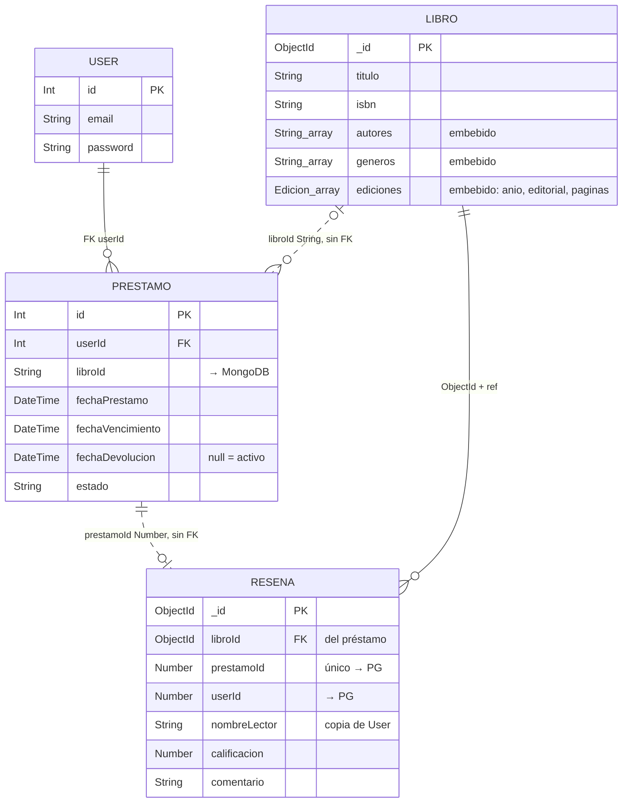

# Tarea individual U2 · Modelo híbrido PostgreSQL + MongoDB

**Estudiante:** Frank Marco Alvarado Grefa  **N.º de lista:** 1  **Caso:** 1 · Biblioteca

> Mismo formato que el workload del material de Modelado (lección 2.2) y que el ejemplo resuelto de la clínica
> (`docs/ejemplo_clinica/Workload_clinica_hibrida.md`). Cada operación agrega la fila **Base**.

## 1. Workload

### 1.1 Casos de uso
- Una biblioteca universitaria atiende a ~2 000 lectores que buscan libros en el catálogo, piden prestado un ejemplar y lo devuelven.
- Después de devolver el libro, el lector deja una reseña del préstamo (calificación de 1 a 5 y comentario).
- Los lectores consultan el catálogo, el detalle de cada libro con sus ediciones, sus propios préstamos y las reseñas de cada libro.
- El bibliotecario registra las devoluciones y mantiene el catálogo de libros.

### 1.2 Datos principales (cuántos actores, cuántos registros, cuánto tiempo se guardan)
- Lectores: 2 000 (crecen ~40 por mes). Bibliotecarios: 3.
- Libros: ~10 000 (~30 altas por mes). Cada libro tiene 1 a 4 autores, 1 a 3 géneros y 1 a 5 ediciones.
- Préstamos: ~500 por día (~912 500 en 5 años). Se guardan 5 años como historial.
- Reseñas: ~100 por día (~182 500 en 5 años, unos 90 MB a ~0,5 KB cada una). **Crecen sin límite.**
- Un libro no se presta dos veces a la vez: máximo 1 préstamo activo por libro.

### 1.3 Suposiciones (lo que puede cambiar)
- Un libro es un ejemplar único; mientras tiene un préstamo sin devolver, no se puede prestar de nuevo (integridad fuerte).
- Un préstamo dura 14 días y solo se reseña un préstamo propio y ya devuelto.
- Un préstamo tiene como máximo **una** reseña.
- El nombre del lector casi nunca cambia: se puede copiar en la reseña.
- El catálogo cambia pocas veces al mes, pero cada libro puede tener campos distintos (traductores, colección, ediciones).
- Las reseñas se muestran por libro, las más nuevas primero, con el promedio y el total.
- Si la biblioteca crece, las consultas al catálogo y las reseñas crecerán mucho más que los préstamos.

### 1.4 Operaciones (mínimo 6, una tabla por operación)

| Actor: | Lector |
|---|---|
| Descripción: | Busca libros por título o autor (`?q=`), con proyección (`?fields=`) y orden |
| Tipo de operación: | Lectura |
| Datos en la operación: | titulo, autores[], generos[], isbn |
| Frecuencia: | En cada visita al catálogo; picos de 10:00 a 13:00 |
| Tasa: | ~20 000 / día |
| Base: | **MongoDB** (forma variable, lectura masiva y sin joins) |

| Actor: | Lector |
|---|---|
| Descripción: | Consulta el detalle de un libro con todas sus ediciones |
| Tipo de operación: | Lectura |
| Datos en la operación: | Libro completo con ediciones[] embebidas (anio, editorial, paginas) |
| Frecuencia: | Al abrir un libro del catálogo |
| Tasa: | ~8 000 / día |
| Base: | **MongoDB** (un solo documento trae todo; las ediciones se leen junto con el libro) |

| Actor: | Lector |
|---|---|
| Descripción: | Solicita el préstamo de un libro |
| Tipo de operación: | Escritura |
| Datos en la operación: | libroId, fechaPrestamo, fechaVencimiento (+14 días), userId (del JWT) |
| Frecuencia: | Todo el día; picos al inicio de cada clase |
| Tasa: | ~500 / día |
| Base: | **PostgreSQL** (integridad: un solo préstamo activo por libro); lee MongoDB para validar `libroId` |

| Actor: | Bibliotecario |
|---|---|
| Descripción: | Registra la devolución de un préstamo |
| Tipo de operación: | Escritura |
| Datos en la operación: | id del préstamo, fechaDevolucion, estado |
| Frecuencia: | Todo el día; casi tantas como préstamos |
| Tasa: | ~450 / día |
| Base: | **PostgreSQL** (actualización transaccional que libera el libro) |

| Actor: | Lector |
|---|---|
| Descripción: | Ve sus préstamos con título y autores de cada libro |
| Tipo de operación: | Lectura |
| Datos en la operación: | préstamos del usuario + libroId, fechas, estado (PostgreSQL) + titulo, autores (MongoDB) |
| Frecuencia: | Cada lector activo, ~1 vez al día |
| Tasa: | ~1 500 / día |
| Base: | **Las dos**: se une en el servicio con `$in` + `Map` (2 consultas, sin N+1) |

| Actor: | Lector |
|---|---|
| Descripción: | Deja una reseña de un préstamo propio y ya devuelto |
| Tipo de operación: | Escritura |
| Datos en la operación: | prestamoId, calificacion, comentario; userId del JWT; libroId tomado del préstamo; nombreLector copiado de PostgreSQL |
| Frecuencia: | Uno de cada cinco préstamos |
| Tasa: | ~100 / día (~182 500 en 5 años) |
| Base: | **MongoDB**, colección aparte; lee PostgreSQL para validar el préstamo (404) y su dueño (403) |

| Actor: | Lector (o visitante) |
|---|---|
| Descripción: | Lee las reseñas y el promedio de un libro |
| Tipo de operación: | Lectura |
| Datos en la operación: | nombreLector, calificacion, comentario, createdAt; promedio y total |
| Frecuencia: | Al abrir un libro |
| Tasa: | ~5 000 / día |
| Base: | **MongoDB** solamente (por eso se copia `nombreLector`) |

| Actor: | Bibliotecario |
|---|---|
| Descripción: | Crea o edita un libro |
| Tipo de operación: | Escritura |
| Datos en la operación: | todos los campos del libro |
| Frecuencia: | Pocas veces al mes |
| Tasa: | ~30 / mes |
| Base: | **MongoDB** |

| Actor: | Bibliotecario |
|---|---|
| Descripción: | Elimina un libro |
| Tipo de operación: | Escritura |
| Datos en la operación: | _id del libro; conteo de préstamos que lo usan |
| Frecuencia: | Casi nunca |
| Tasa: | ~1 / mes |
| Base: | **MongoDB**, revisando PostgreSQL (409 si hay préstamos; si no, borra sus reseñas) |

### 1.5 Entidades

- **PostgreSQL**
  - User
    - Prestamo (1:N, FK `userId`)
- **MongoDB**
  - Libro
    - Resena (1:N, `libroId` ObjectId + ref)
    - autores[], generos[], ediciones[] (embebidos)
- **Entre bases (sin FK)**
  - Prestamo.libroId → Libro._id (String)
  - Resena.prestamoId → Prestamo.id (Number, único)
  - Resena.userId → User.id (Number) · Resena.nombreLector (copia)

### 1.6 Observaciones (qué domina: lectura o escritura, qué crece sin límite, qué necesita integridad)
- Hay ~33 lecturas por cada escritura (~34 500 lecturas frente a ~1 050 escrituras al día): lo que más se lee debe salir de una sola consulta.
- Lo único que crece sin límite son las reseñas: van en su propia colección, nunca embebidas en el libro (límite de 16 MB por documento).
- El préstamo necesita integridad (un libro no tiene dos préstamos activos): se queda en PostgreSQL.
- `nombreLector` se copia porque la lista de reseñas se lee ~5 000 veces al día y el nombre casi no cambia. Costo: si cambia, las reseñas viejas guardan el anterior.
- Índices que pide el workload: `Prestamo.libroId` y `Prestamo.userId` con `@@index` y un índice único parcial sobre `libroId` donde `fechaDevolucion` es nulo (PostgreSQL); `resenas.prestamoId` único y `resenas { libroId: 1, createdAt: -1 }` (MongoDB).

## 2. ¿PostgreSQL o MongoDB?

| Entidad | ¿Transacciones o choques? | ¿Otras dependen por FK? | ¿Forma variable? | ¿Crece sin límite? | ¿Se lee mucho más? | Base |
|---|---|---|---|---|---|---|
| User | Sí (login, unicidad de email) | Sí (Prestamo.userId) | No | No | No | PostgreSQL |
| Prestamo | Sí (un libro no se presta dos veces a la vez) | Sí (hacia User) | No | Moderado (historial de 5 años) | No | PostgreSQL |
| Libro | No (rara vez dos escrituras chocan) | No (la referencia es un String sin FK) | Sí (autores, géneros, ediciones) | No | Sí (~28 000 lecturas frente a ~1 escritura por día) | MongoDB |
| Resena | No (solo un único por préstamo) | No | No | Sí (sin límite) | Sí | MongoDB |

## 3. Relaciones dentro de MongoDB: embeber o referenciar

| Relación | Cardinalidad | ¿Se lee junto? | ¿Cambia seguido? | ¿Crece sin límite? | Decisión |
|---|---|---|---|---|---|
| Libro → ediciones | 1:N (pocas) | Sí, siempre con el libro | No | No | Embeber |
| Libro → autores | 1:N (pocos) | Sí, siempre con el libro | No | No | Embeber (arreglo de strings) |
| Libro → Resena | 1:N | No, se pide aparte y paginada | Sí (nuevas reseñas) | Sí | Referenciar (`Resena.libroId` con `ref: "Libro"`) |

## 4. ERD híbrido (notación pata de gallo, como el material 2.1)

Dos zonas, PostgreSQL y MongoDB; cada entidad con sus campos y tipos; lo embebido dentro de la entidad (`campo: [Tipo]`).
Línea continua: FK de PostgreSQL o `ref` de Mongoose. **Línea punteada: referencia entre bases** (sin FK).

## 5. Referencias

| Referencia | Se guarda como | La garantiza | Se une con |
|---|---|---|---|
| Prestamo → User | `userId Int` (FK) | PostgreSQL (clave foránea) | `include` de Prisma |
| Prestamo → Libro | `libroId String?` (sin FK) | El servicio: `isValidObjectId` + `Libro.exists` al crear | `Libro.find({ _id: { $in: ids } })` y un `Map` |
| Resena → Prestamo | `prestamoId Number` (sin FK) | El servicio: `prisma.prestamo.findUnique` (404) y dueño del token (403); índice único (409) | Consulta por `prestamoId` con Prisma |
| Resena → User | `userId Number` (sin FK) | El JWT: el id sale del token, no del body | Consulta por `userId` con Prisma |
| Resena → Libro | `libroId ObjectId` con `ref` | Mongoose y el servicio | `populate("libroId")` |

## 6. Dato copiado entre bases (desnormalización)

- Dato: `nombreLector`, el nombre del `User` (PostgreSQL), copiado a la reseña (MongoDB) al crearla.
- Por qué (operación del workload): la lista de reseñas de un libro se lee unas 5 000 veces al día y debe salir solo de MongoDB, sin consultar PostgreSQL por cada reseña. El nombre casi nunca cambia.
- Costo: si el lector cambia su nombre, las reseñas antiguas conservan el anterior. Cuesta además un campo más por reseña.
- Nota: `libroId` en la reseña no es una copia libre: se toma del préstamo validado y es la referencia (`ref`) que permite el `populate` y el `aggregate` por libro; como `Prestamo.libroId` no se edita, no se desincroniza.

## 7. Endpoints

| Método y ruta | Base(s) | Respuestas posibles |
|---|---|---|
| `POST /api/libros` (JWT) | MongoDB | 201, 400, 401 |
| `GET /api/libros?q=&fields=&sort=` | MongoDB | 200 |
| `GET /api/libros/:id` | MongoDB | 200, 400, 404 |
| `PUT /api/libros/:id` (JWT) | MongoDB | 200, 400, 401, 404 |
| `DELETE /api/libros/:id` (JWT) | Las dos | 204, 400, 401, 404, 409 (tiene préstamos) |
| `POST /api/prestamos` (JWT) | Las dos | 201, 400 (libroId inválido), 401, 404 (libro no existe), 409 (libro ya prestado) |
| `PATCH /api/prestamos/:id/devolucion` (JWT) | PostgreSQL | 200, 401, 403, 404, 409 (ya devuelto) |
| `GET /api/prestamos/mios` (JWT) | Las dos | 200, 401 |
| `POST /api/resenas` (JWT) | Las dos | 201, 400, 401, 403 (no es su préstamo), 404 (préstamo no existe), 409 (ya tiene reseña) |
| `GET /api/libros/:id/resenas` | MongoDB | 200, 400, 404 |